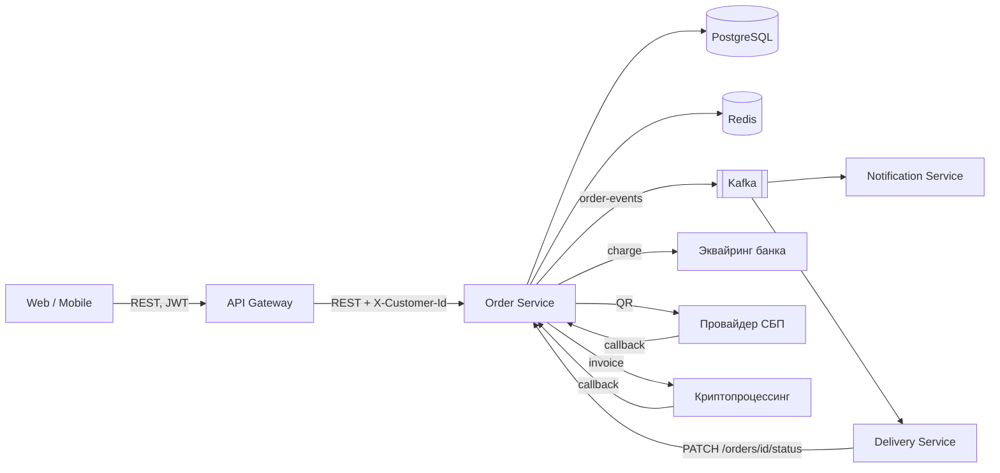
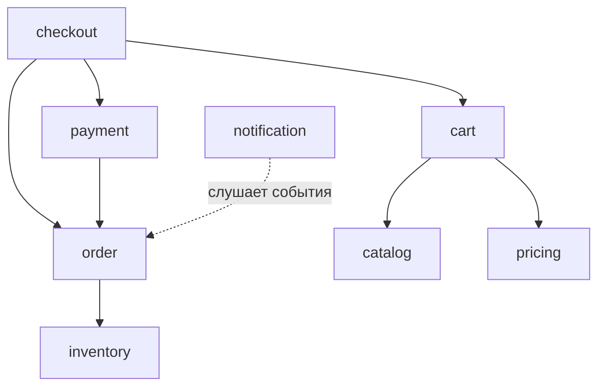
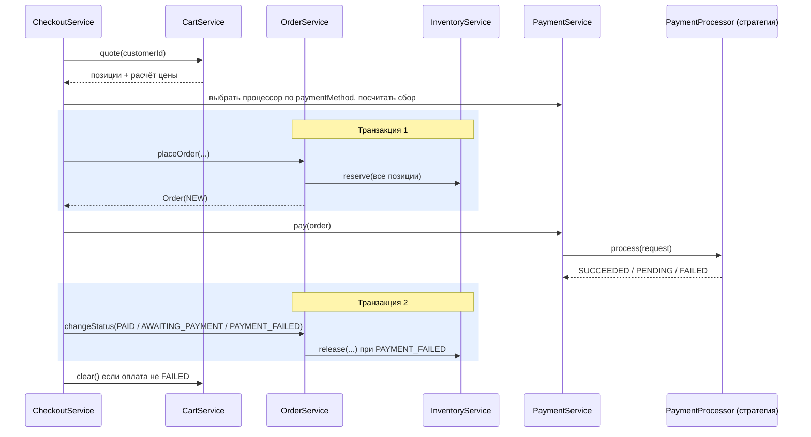

# Архитектура Order Service

Документ описывает **целевую** архитектуру, согласованную с архитектором заказчика на старте проекта
(см. [ADR-0001](adr/0001-modular-structure.md)). Если код с ним расходится, прав документ: значит, это
техдолг или баг.

## 1. Контекст

## 2. Модули и правила зависимостей

Сервис построен как **модульный монолит**: один деплой, но пакеты верхнего уровня — это модули
с явными границами.

Правила:

1. **Зависимости направлены строго сверху вниз по схеме.** Циклы запрещены и на уровне бинов, и на уровне пакетов.
2. `pricing` — чистый доменный сервис: на вход получает позиции и промокод, возвращает расчёт.
   **Он ничего не знает о корзине**: тот же расчёт переиспользуют при пересчёте заказа и в админке.
3. `order` не знает о Kafka. Модуль публикует доменные события, а `notification` решает, куда их отправить.
4. Сущности JPA не покидают свой модуль и не уходят в HTTP-ответы. Наружу отдаются DTO (`record`).
5. Контроллеры тонкие: только HTTP-маппинг и валидация. Вся работа с данными идёт внутри
   транзакционного сервисного метода. `spring.jpa.open-in-view` выключен намеренно.

## 3. Оформление заказа (checkout)

Ключевые решения:

- **`CheckoutService` не транзакционный.** Оплата — внешний HTTP-вызов, который может длиться секунды.
  Держать на это время соединение с БД и блокировки нельзя.
- **Транзакция 1 атомарна**: заказ и резерв всех позиций создаются вместе или не создаются вовсе.
  Если на третью позицию товара не хватило, резерв первых двух откатывается.
- **Компенсация.** Если оплата не прошла, резерв снимается. Это упрощённая сага: шаги атомарны по
  отдельности, а целостность всего процесса обеспечивают компенсирующие действия.

## 4. Оплата

Подробности — в [ADR-0002](adr/0002-payment-methods.md).

- Каждый способ оплаты реализует `PaymentProcessor` (паттерн **Strategy**).
- Нужная реализация выбирается по `PaymentMethod` из реестра, который Spring собирает из всех бинов-стратегий.
- Всё, что зависит от способа оплаты (сервисный сбор, обязательность токена, конвертация валют),
  живёт **внутри стратегии**. Нигде в коде не должно быть `switch (paymentMethod)`.
- **Новый способ оплаты = один новый класс** (+ миграция и конфиг, если нужны). Существующие классы не меняются (OCP).
- Асинхронные способы (СБП, крипто) возвращают `PENDING`. Финальный статус приходит callback-ом
  на `/api/v1/payments/callback`. Провайдеры доставляют callback по схеме **at-least-once**, поэтому
  обработчик обязан быть **идемпотентным**.

## 5. Жизненный цикл заказа

Допустимые переходы статусов перечислены в [SPECIFICATION.md](SPECIFICATION.md#5-статусы-заказа).
Проверка перехода — ответственность доменной модели (`Order`/`OrderStatus`), а не вызывающего кода.
Поэтому изменить статус в обход правил не может ни контроллер, ни callback, ни сервис доставки.

## 6. События

- После каждого изменения статуса `order` публикует доменное событие `OrderStatusChanged`
  (паттерн **Observer** через `ApplicationEventPublisher`).
- `notification` слушает событие и отправляет сообщение в топик `shopflow.order-events`
  (контракт — [asyncapi.yaml](api/asyncapi.yaml)).
- **Сообщение уходит только после коммита транзакции**: потребители не должны узнавать о заказах,
  которых нет в БД.
- **Ключ сообщения — `orderId`.** Kafka гарантирует порядок только внутри партиции. Сервис доставки
  должен получать события одного заказа строго по порядку.
- Целевое решение — Transactional Outbox ([ADR-0003](adr/0003-order-events.md)). На первом этапе достаточно
  `@TransactionalEventListener(phase = AFTER_COMMIT)`.

## 7. Кэширование

- Карточки товаров кэшируются в Redis (`products`, TTL 10 минут). Это cache-aside через `@Cacheable`.
- В кэш кладётся **DTO**, а не JPA-сущность.
- Изменение цены **сразу** инвалидирует кэш этого товара. Покупатель не должен оплачивать заказ по старой цене.

## 8. Склад и конкурентный доступ

- Остатки списываются атомарно на уровне БД (условный `UPDATE ... WHERE available >= :qty`) или
  с оптимистической блокировкой (`@Version`). Схема «прочитать → проверить в Java → записать»
  под нагрузкой приводит к овер-продажам.

## 9. Безопасность

- Аутентификацию выполняет API Gateway и передаёт `X-Customer-Id`. Сервис этому заголовку доверяет.
- **Авторизация — ответственность сервиса**: покупатель видит и меняет только свои заказы и корзину.
  Для чужого заказа ответ должен быть таким же, как для несуществующего (`404`). Так мы не раскрываем,
  что заказ существует.
- `PATCH /orders/{id}/status` и `/payments/callback` закрыты на уровне сети (internal ingress).
- Платёжные токены, номера карт и персональные данные **не попадают в логи** (требование PCI DSS).

## 10. Обработка ошибок

Единый формат ошибки — `ErrorResponse` (см. OpenAPI). Соответствие исключений HTTP-кодам:

| Ситуация | Код | `code` |
|---|---|---|
| Ошибка валидации запроса | 400 | `VALIDATION_ERROR` |
| Ресурс не найден или чужой | 404 | `NOT_FOUND` |
| Конфликт состояния (нет остатка, недопустимый переход статуса) | 409 | `OUT_OF_STOCK`, `ILLEGAL_STATUS_TRANSITION` |
| Нарушение бизнес-правила | 422 | `CART_EMPTY`, `PROMO_CODE_*`, `PAYMENT_*` |
| Всё остальное | 500 | `INTERNAL_ERROR` |
