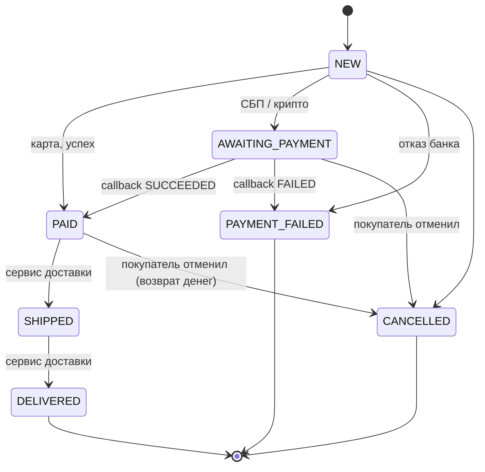

# Спецификация (ТЗ) Order Service

Версия 1.3 · согласовано с заказчиком (Ольга Н., PM ООО «ШопФлоу Ритейл»)

## 1. Корзина

1.1. У каждого покупателя одна корзина. Корзина создаётся при первом добавлении товара.

1.2. Повторное добавление того же товара **увеличивает количество** в существующей строке и не создаёт новую строку.

1.3. Количество товара в одной операции — от 1 до 99. Некорректные значения отклоняются с кодом `400`.

1.4. В корзину можно добавить только активный товар. Цена в корзине всегда актуальная: корзина хранит
не цену, а ссылку на товар.

1.5. Ответ любого изменяющего запроса к корзине — актуальное представление корзины (`CartView`).

## 2. Промокоды

2.1. В корзине может быть применён один промокод. Код нечувствителен к регистру (`sale15` = `SALE15`).

2.2. Типы промокодов:

| Тип | Значение `value` | Скидка |
|---|---|---|
| `PERCENTAGE` | процент, 0–100 | `subtotal × value / 100` |
| `FIXED_AMOUNT` | сумма в рублях | `value` |

> **Планы на Q4 (от маркетинга):** промокоды «N+1 в подарок» и «бесплатная доставка». Добавление нового
> типа промокода не должно требовать правок в расчёте существующих.

2.3. Промокод действует в интервале `[valid_from, valid_to)`, если `active = true` и сумма корзины
не меньше `min_order_amount`.

2.4. **Скидка не может превышать сумму корзины. Итог к оплате не может быть отрицательным.**

2.5. Если промокод перестал действовать (истёк, сумма корзины стала меньше минимальной), корзина
показывает статус промокода (`promoCodeStatus`), а оформление заказа возвращает `422 PROMO_CODE_INVALID`.

## 3. Деньги и округление

3.1. Все суммы в рублях хранятся с точностью 2 знака после запятой (`numeric(12,2)`). Округление — `HALF_UP`.

3.2. **Распределение скидки по позициям (54-ФЗ).** Онлайн-касса требует указать скидку по каждой позиции чека:

- скидка распределяется **пропорционально стоимости позиции** (`lineTotal`);
- сумма скидок по позициям **точно равна** общей скидке. Остаток от округления (копейки) относится
  на последнюю позицию;
- скидка на позицию не может превышать её стоимость.

Пример: скидка 10,00 ₽ на три позиции по 100 ₽ распределяется как 3,33 + 3,33 + 3,34.

3.3. Для расчётов с деньгами нельзя использовать `double`/`float`, а `BigDecimal` нельзя сравнивать через `equals`.

## 4. Способы оплаты

| Способ | Код | Тип | Сервисный сбор | Токен | Подтверждение |
|---|---|---|---|---|---|
| Банковская карта | `CARD` | синхронный | 0 % | обязателен (`paymentToken` от платёжного виджета) | сразу в ответе банка |
| СБП | `SBP` | асинхронный | 0 % | не нужен | callback |
| Криптовалюта (BTC) | `CRYPTO` | асинхронный | **1,5 %** от суммы заказа | не нужен | callback после подтверждений сети |

4.1. Сервисный сбор прибавляется к итогу заказа: `total = subtotal − discount + paymentFee`.

4.2. **СБП.** Сервис формирует ссылку для динамического QR-кода. Сумма в QR передаётся **в копейках**.
Заказ ожидает оплату в статусе `AWAITING_PAYMENT`.

4.3. **Криптовалюта.** Сумма заказа в рублях конвертируется в BTC по курсу из конфигурации
(`shopflow.payment.crypto.rub-rate`). Сумма к оплате указывается **с точностью до сатоши (8 знаков)**
и округляется **вверх**, чтобы магазин не недополучил оплату. Покупателю выдаётся уникальный адрес кошелька.
Заказ ожидает оплату в статусе `AWAITING_PAYMENT`.

4.4. **Callback.** Провайдеры СБП и криптопроцессинга присылают финальный статус платежа
(`SUCCEEDED`/`FAILED`) на `/api/v1/payments/callback`. Провайдер **может прислать одно и то же
уведомление несколько раз** (at-least-once): повторная обработка не должна ничего менять.

4.5. Если банк недоступен или вернул ошибку, заказ переходит в `PAYMENT_FAILED`.
Покупатель может оформить заказ заново: корзина при неуспешной оплате **не очищается**.

## 5. Статусы заказа

5.1. Любой переход, которого нет на диаграмме, запрещён и возвращает `409 ILLEGAL_STATUS_TRANSITION`.

5.2. **Отправленный (`SHIPPED`) или доставленный (`DELIVERED`) заказ отменить нельзя.** Возврат
доставленного товара оформляется отдельным процессом и в этот сервис не входит.

5.3. При переходе в `CANCELLED` или `PAYMENT_FAILED` зарезервированный товар возвращается на склад.

## 6. Склад

6.1. Товар резервируется в момент оформления заказа: доступный остаток уменьшается сразу.

6.2. Продать больше, чем есть на складе, нельзя **ни при каких условиях**, в том числе при одновременных
покупках (распродажи, «Чёрная пятница»).

6.3. Если какой-либо позиции не хватает, заказ не создаётся (`409 OUT_OF_STOCK`), а остатки
**всех** позиций остаются прежними.

## 7. Уведомления

7.1. При каждом изменении статуса заказа (включая создание) в Kafka публикуется событие
(контракт — [asyncapi.yaml](api/asyncapi.yaml)).

7.2. Событие публикуется только для изменений, которые **реально сохранены** в БД.

7.3. События одного заказа потребитель получает **в том порядке, в котором они произошли**.

## 8. Доступ к данным

8.1. Покупатель видит и может отменить только свои заказы. Попытка обратиться к чужому заказу
выглядит так же, как обращение к несуществующему (`404`).

## 9. Нефункциональные требования

9.1. Время ответа API (без учёта внешних провайдеров): p95 < 300 мс.

9.2. Изменение цены товара видно покупателям сразу после сохранения.

9.3. Логи не содержат платёжных токенов и персональных данных (PCI DSS, 152-ФЗ).

9.4. Сервис стартует на пустой БД: схему создают миграции Flyway. Для стенда достаточно `docker compose up`.
